# InstaVizer — User Manual

InstaVizer is a visual analytics tool for comparing many instantiations of the same Entity-Relationship schema. One schema and any number of instance files are loaded, then interactive charts, colouring, grouping, and filtering tools can be used to spot clusters, outliers, and differences across instances.

Everything is schema-agnostic: the tool reads the entities, relations, and attributes declared by the schema and adapts the visualisations to them, with no assumptions about the domain.

---

## Input format

Two kinds of file are needed: one schema file and any number of instance files.

### Schema file

The schema file is a JSON object with `entities` and `relations`. Each entity lists `properties`; each property has a `name` and a `dtype`. Supported dtypes are `enum` (which carries a `values` list), `int`, `float`, `bool`, and `string`. The `relations` object maps, for every entity, each outgoing relation to its target entities, with an optional `properties` array.

> [!NOTE]
> `string` attributes are supported but not visualised in the charts. Properties defined on relations are supported but not visualised.

```json
{
  "entities": {
    "StudyProgram": {
      "properties": [
        { "name": "degreeLevel", "dtype": "enum", "values": ["Bachelor", "Master"] },
        { "name": "ectsTotal", "dtype": "int" }
      ]
    },
    "Department": {
      "properties": [
        { "name": "name", "dtype": "string" }
      ]
    }
  },
  "relations": {
    "StudyProgram": {
      "offeredBy": {
        "Department": { "properties": [] }
      }
    }
  }
}
```

### Instance file

Each instance file is a JSON object with `elements.nodes` and `elements.edges` (each wrapped in a `data` object). A node's `data` has an `id`, a `name` matching a schema entity, and a `properties` array of `{name, value}`. An edge's `data` has a `name` matching a relation, plus `source` and `target` node ids.

```json
{
  "elements": {
    "nodes": [
      { "data": { "id": "n1", "name": "StudyProgram",
        "properties": [
          { "name": "degreeLevel", "value": "Master" },
          { "name": "ectsTotal", "value": 120 }
        ] } }
    ],
    "edges": [
      { "data": { "name": "offeredBy", "source": "n1", "target": "n2" } }
    ]
  }
}
```

>[!IMPORTANT]
> Only binary relations are supported.

---

## Getting started

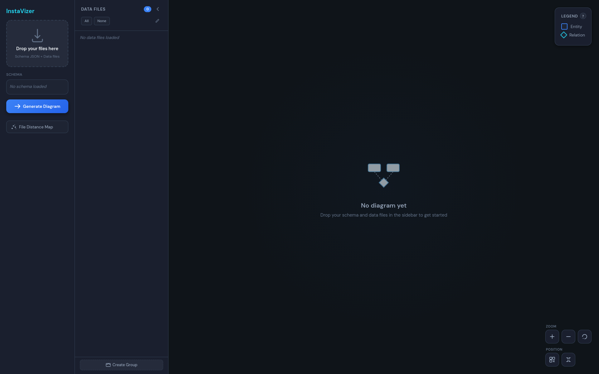


1. Files are loaded by dragging and droppoing in the drop zone in the top-left panel (or clicking it to browse). Load one schema file and the instance files to be analysed.

2. Once a schema is recognised it appears in the **Schema** slot, and instance files fill the **Data Files** sidebar on the left.

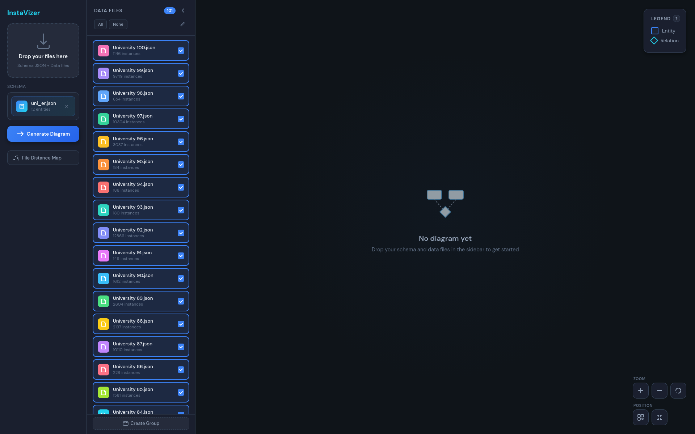

3. Clicking **Generate Diagram** renders the interactive ER diagram.

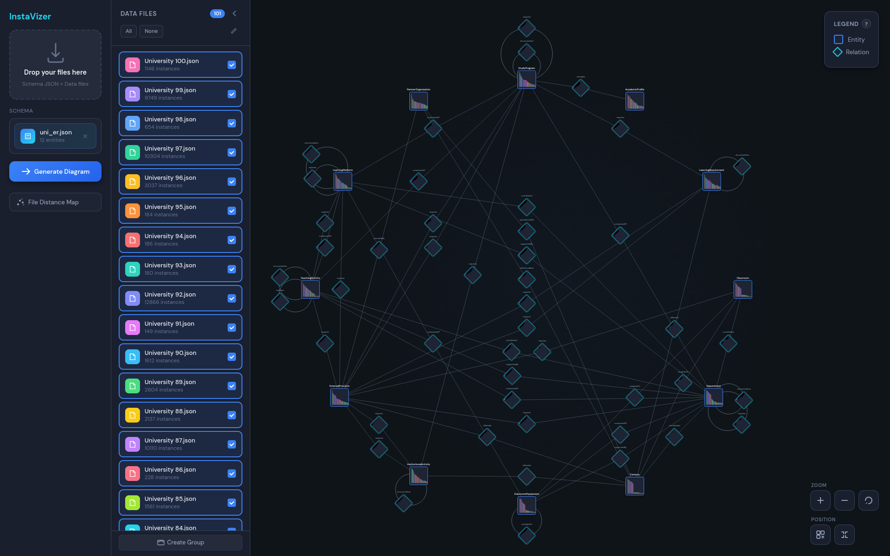

Loaded instance files stay available across every chart. Selecting, colouring, grouping, and filtering them affects all visualisations at once.

---

## The main graph visualisation

The diagram is a live picture of the schema. Each **entity** is drawn as a square node and each **relationship** as a diamond, connected by lines that follow the schema's structure. Self-referencing relations loop back on the entity.

Controls are at the bottom right. It's possible to:

- **Pan** by dragging the background, and **zoom** with the scroll wheel or the zoom controls.
- **Drag any node** to rearrange the layout; positions are remembered.
- **Click a node** to open a chart regarding that entity or relation (see [Per-node charts](#per-node-charts)).
- **Multi-select nodes** to move several at once.
- **Reset** node positions

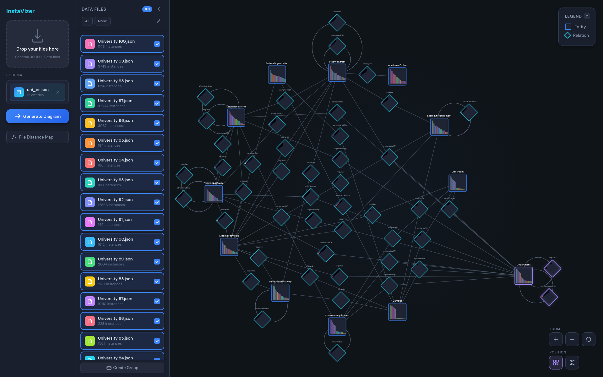

Node position is cached and restored on reload.

Every node is also a small chart summarising the data in the currently enabled files, the whole schema doubles as a dashboard. The thumbnails update as files are enabled, disabled, coloured, or grouped.

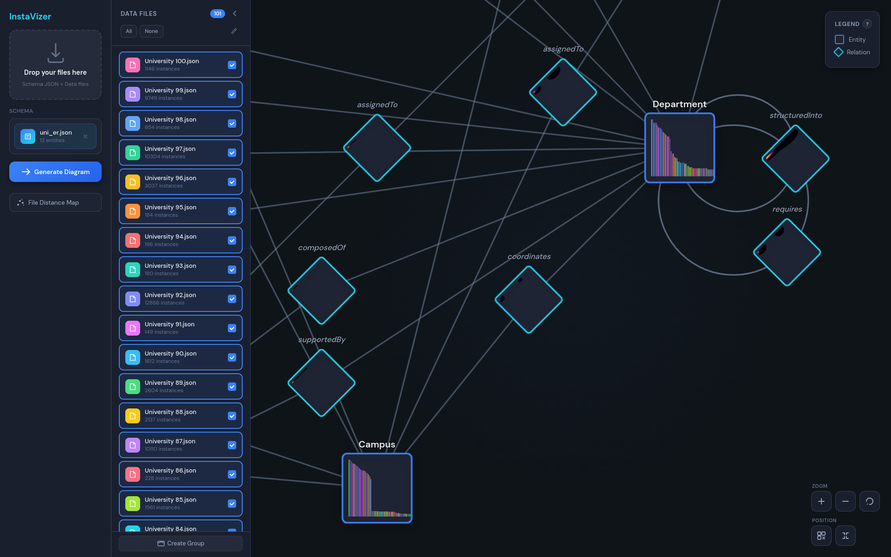


### Mini charts inside the nodes

- Entity nodes show instance-count bars. Inside each entity square is a miniature bar chart: one bar per enabled file, showing how many instances of that entity the file contains, sorted tallest to shortest. Each bar takes on its file's colour.

- Relationship nodes show a connection-density heatmap. Inside each diamond is a small density heatmap (brighter means denser) that combines two factors of the enabled files: the per-file count of that relationship on the bottom-left axis, and the combined distribution of how many connections each entity participates in (its degree) on the top-left axis. The thumbnail normalises and smooths the data with a kernel density estimate (KDE).

When a file has no data for a node, the thumbnail reads *Empty* or *no data*.

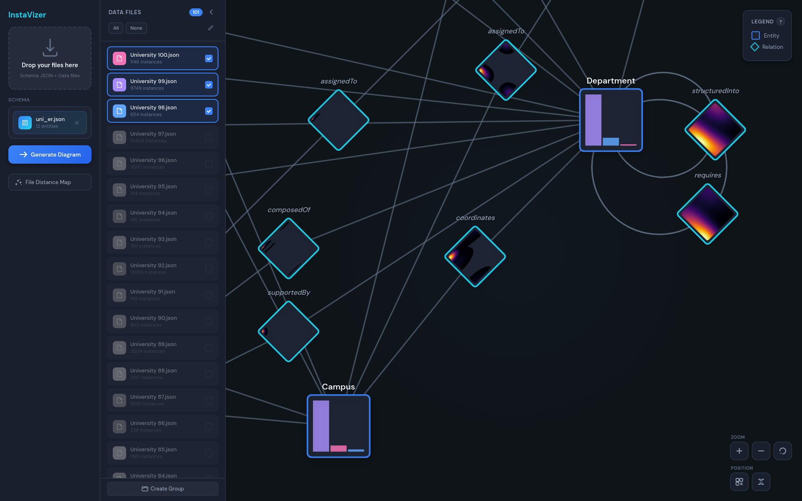

> [!TIP]
> Insight example: the hotspots of "assigned to" show that: the highest relation count files connect to entities with either very low or very high degree, while the lower relation count files contribute only to entities with a low degree"

---

## Per-node charts

Clicking a node opens a menu of detailed charts for that entity or relationship. Each chart opens in a large modal that can be minimised to a floating preview and restore later. The available charts depend on whether an entity or a relationship was selected.

All of these charts respect file selection, colours, groups, and filters.

### 1. Instances per file

*Available for: entities and relationships.*

A bar chart of how many instances each selected file contains, with one bar per file in its file colour. Summary statistics (total, mean, standard deviation, plus or minus two standard deviation bands) are drawn as reference lines and listed below the chart, and hovering a bar shows its exact count and z-score (how far it sits from the mean).

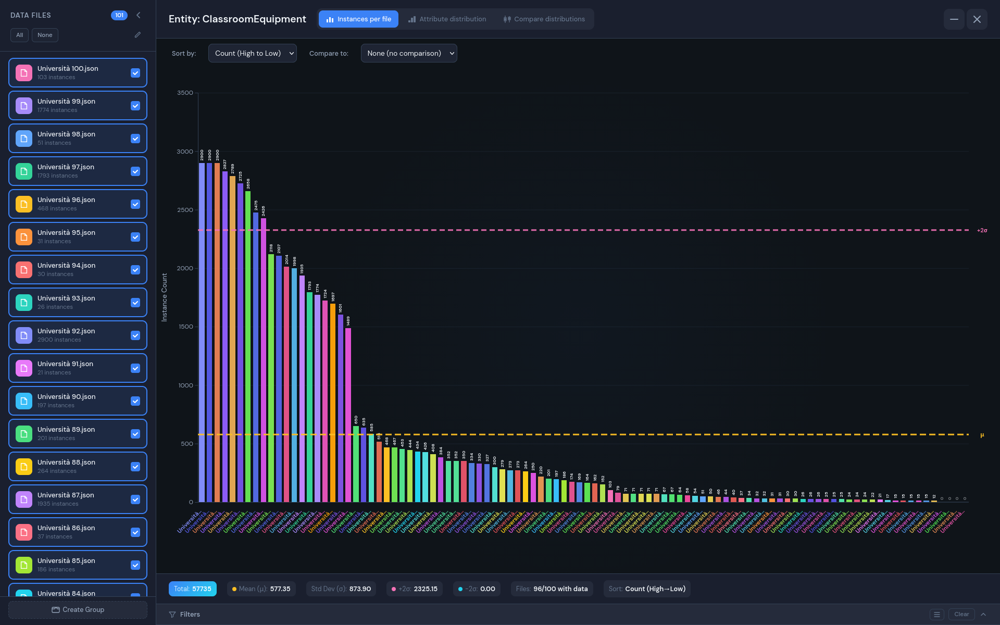

Controls:
- **Sort by**: order bars by count (high to low or low to high) or by file name.
- **Compare to**: switch into comparison mode against either a chosen reference file or the mean. Bars then become diverging, showing how far above or below each file sits relative to the reference. The summary reports how many files are above, below, or equal.

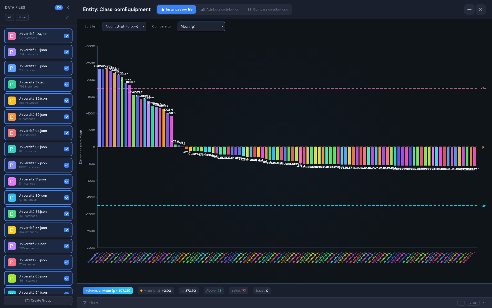

It is also possible to also lasso-select bars to pick out files to add in a group.

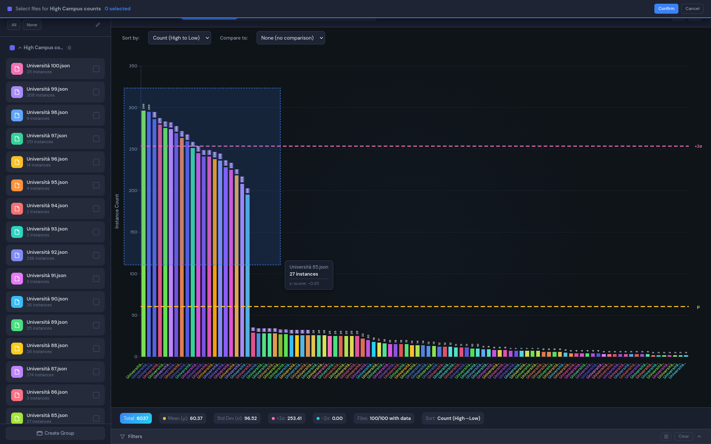

> [!TIP]
> Insight example: theese Universities have many more campuses than others. Grouping them and checking other entity count charts show that they have more entities than others in general (e.g. they are larger Universities)

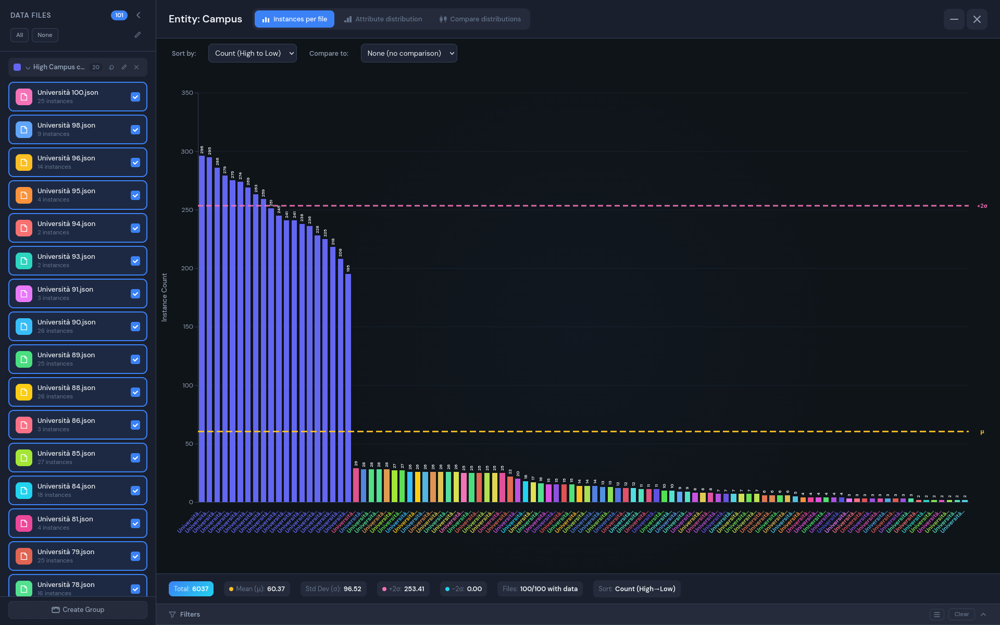

### 2. Attribute distribution

*Available for: entities.*

Shows how the values of a single attribute are distributed, stacked by file to separate each file's contribution to every value or bin.

- Enum attributes are shown as one stacked bar per distinct value, ordered by total frequency.

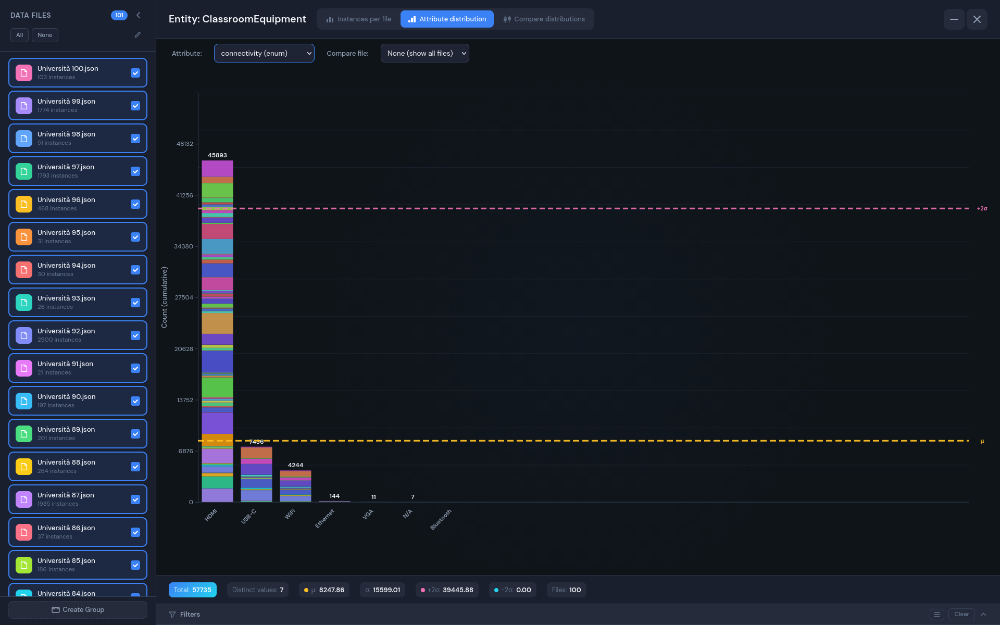


- Bool attributes are shown the same way as enums, with one stacked bar for `true` and one for `false`. The two bars always appear in that order, so they line up when switching between bool attributes.

- Numeric attributes (int/float) are shown as a stacked histogram over automatically computed bins.

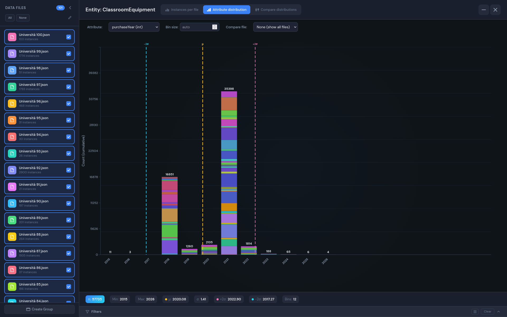

Mean and plus/minus two standard deviation reference lines are drawn over the distribution, and hovering any segment reveals the file, value or bin, and count.

Controls:
- **Attribute**: pick which attribute to chart.
- **Bin size**: for numeric attributes, override the automatic bin width. A bin is one bar's worth of the numeric range: values are grouped into equal-width intervals, and the bin size is the width of each interval (for example, a bin size of 10 groups values 0–10, 10–20, and so on). A smaller bin size gives more, narrower bars and finer detail; a larger bin size gives fewer, wider bars and a smoother shape. Left blank computes an automatic width.
- **Compare file**: isolate one file and show, as a diverging percentage-point chart, how its distribution differs from all the other files combined. This highlights where a single file over- or under-represents particular values.

### 3. Compare distributions (box plots)

*Available for: entities and relationships.*

Box-and-whisker plots that compare a numeric attribute's distribution across categories. For every category a box shows the median, quartiles, whiskers, mean marker, and outliers, with full statistics on hover. This chart highlights how one attribute's spread changes as a second attribute varies.

There are two ways to build the categories:

- Within one entity: thee a numeric **Y attribute** and categorical **X attribute** belong to the same entity. Each X value (or, for a numeric X, each X bin) becomes one box, and that box shows the distribution of Y for the instances falling in that slice of X.

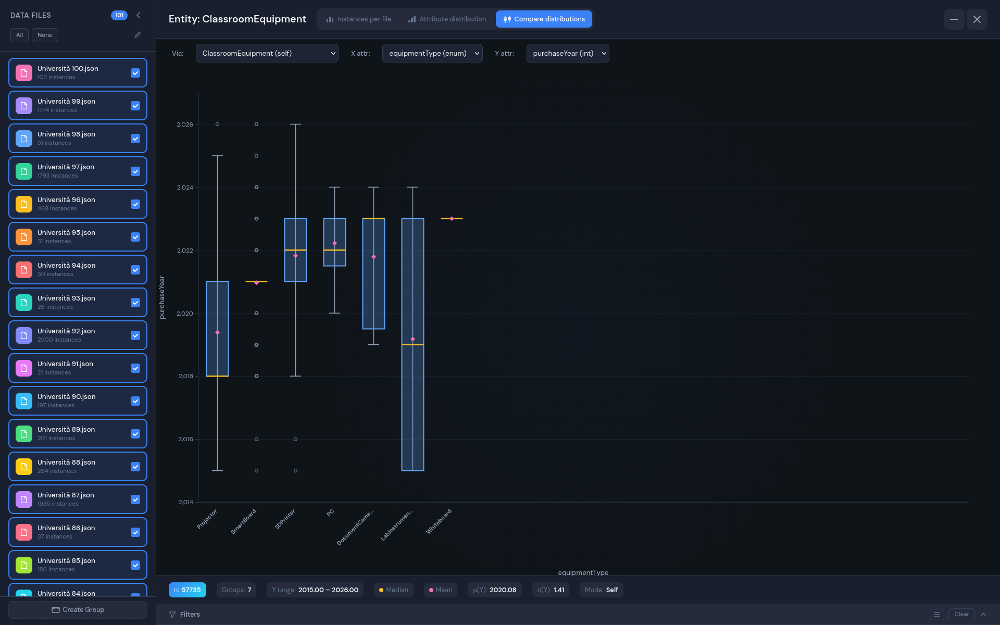

- Across a relationship: a relationship is chosen using the **Via** selector. Now the X attribute comes from one connected entity and the Y attribute from the entity on the other end of the relation. Each box then shows the Y distribution across the entities that share at least one connection (through that relation) with the instances grouped on the X axis. A **swap** button flips which entity sits on the X and which on the Y.

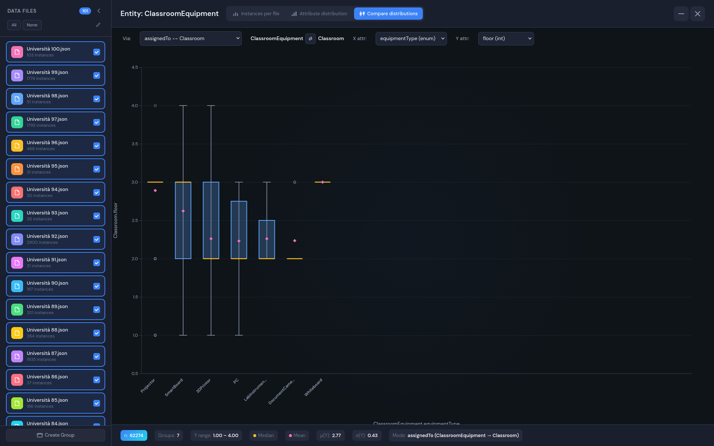

> [!TIP]
> Insight example: almost all projectors are on classrooms on the third floor.

Controls:
- Via (relationship)
- X attribute, Y attribute
- swap X/Y entities
- bin size for a numeric X

### 4. Entity connections

*Available for: relationships.*

A parallel-coordinates view of a relationship's endpoints. Each entity type in the relation becomes a vertical axis; individual entity instances are dots grouped and coloured by file, and each relationship instance is drawn as a line connecting the two endpoints. Coloured bars beside each axis show how many instances belong to each file.

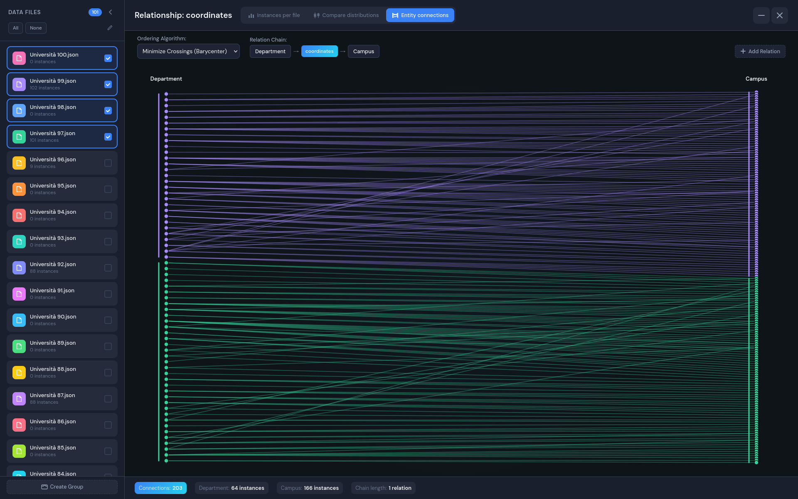

It is possible to extend the chain, adding further connected relationships to place additional axes side by side and trace multi-hop connections across the schema.

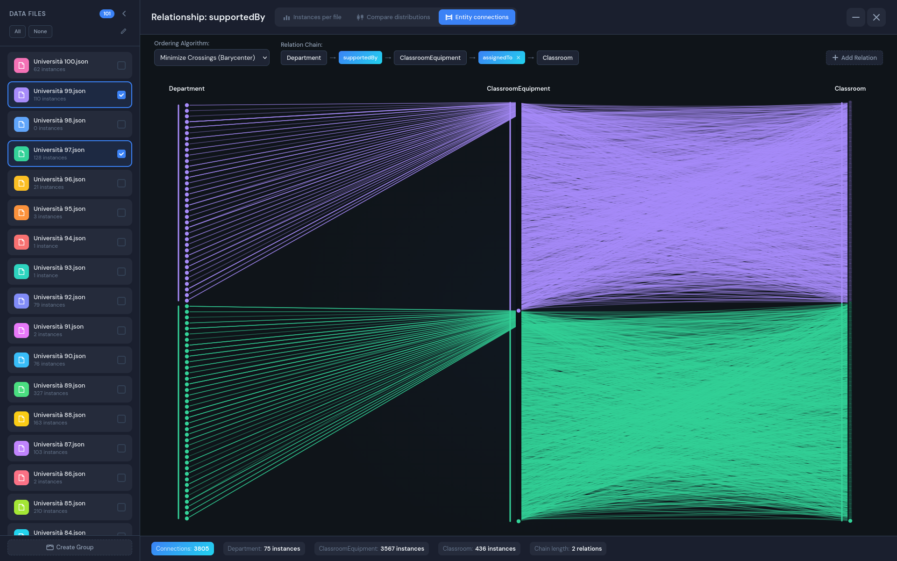

> [!TIP]
> Insight example: only a small subset of the classroom equipment assigned to a classroom supports a specific department


Hovering a dot or line highlights the connections that touch it. The dots can be reordered by different algorithms (a heuristic to minimise line crossings, sort by number of connections, or alphabetically) to make patterns easier to read.


---

## The File Distance Map (special focus)

The **File Distance Map** is the tool's global comparison view. It computes how different every pair of files is, then places the files as bubbles on a 2D scatterplot using Multidimensional Scaling (MDS) so that similar files land near each other and dissimilar files land far apart. Each bubble is a file, in its file colour; bubble size reflects how many instances the file contains (this behaviour can be toggled off).

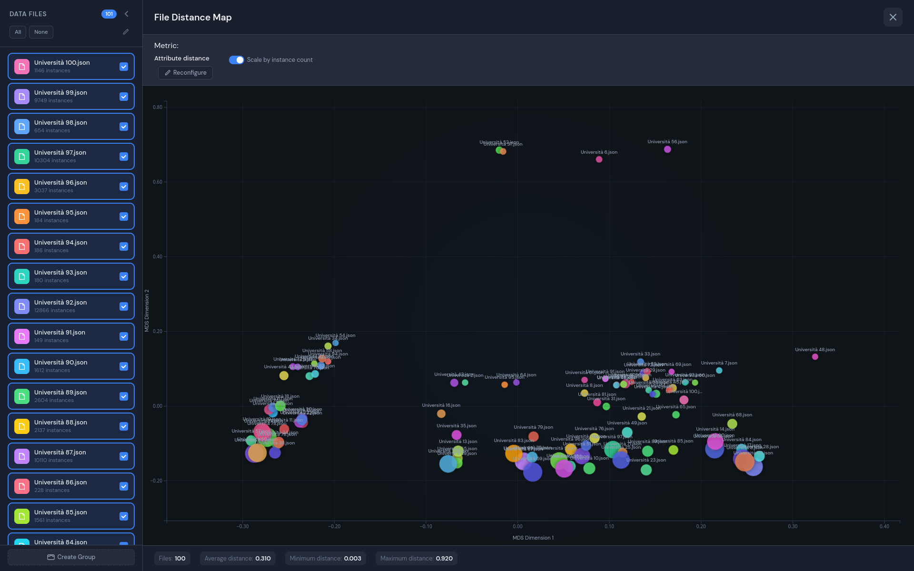

> [!TIP]
> Insight example: this view shows clusters of similar files, as well as some outliers.

It is possible to pan and zoom the map, hovering a bubble draws dashed lines to every other file labelled with the exact pairwise distance 
between themt. A summary below reports the number of files and the average, minimum, and maximum distances. Files can also be **lasso-selected here to build groups.

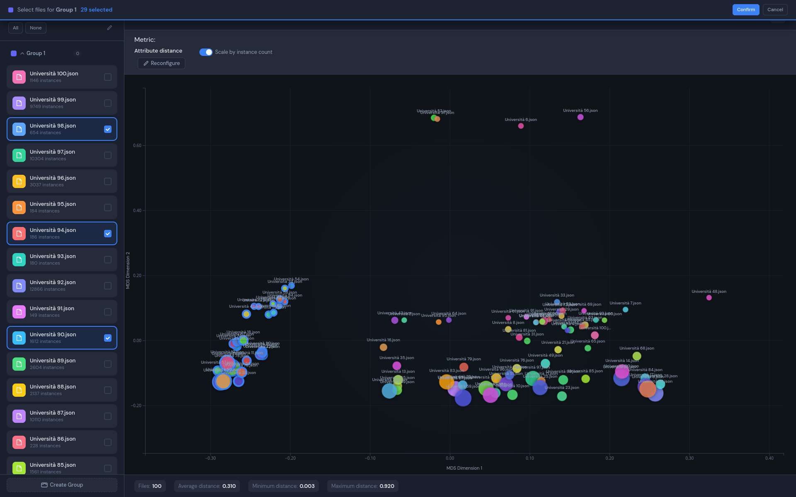

### Distance measures

Distances always run from 0 (identical under the chosen measure) to 1 (maximally different). When opening the map, a setup dialog allows to choose which distance measure to use, tune its options, and optionally apply instance filters before computing. A **Reconfigure** button allows to change the measure or options and recompute.

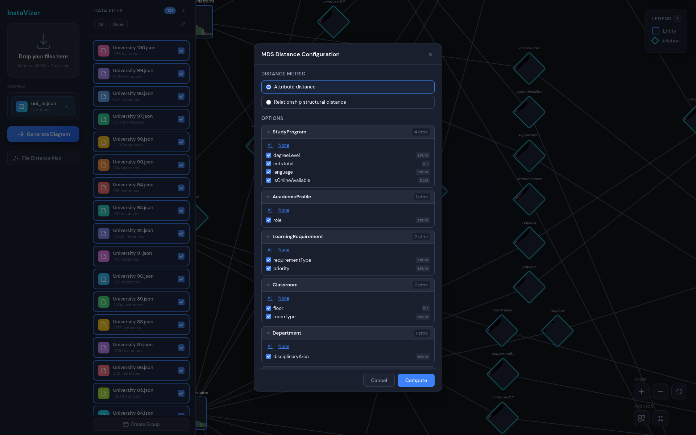

The choice of measure determines what kind of similarity the map reveals.

#### Structural distance

Structural distance compares the shape of the relationships in each file, how entities are connected, while ignoring attribute values entirely. It searches for the largest common wiring pattern shared by two files: the more relationship structure they have in common, the smaller the distance. Two files that connect their entities in the same way score close to 0, even if the specific attribute values differ; files with very different connection structures score close to 1.

This measure comes in two variants, chosen in the setup dialog:

- **Exact**: considers the connection structure thoroughly to find the true best match. Most accurate, but more expensive on large files.
- **Approximate (faster, less accurate)**: samples many candidate matches instead of exhausting every possibility. Much faster on large inputs, at some cost to precision. The trade-off can be tuned with **Samples**, **Max iterations**, and **Match probability** parameters; higher values mean more thorough (and slower) approximation.

Structural distance measures the "topology" of the relation networks, regardless of the values of the attributes they contain.

#### Attribute distance

Attribute distance compares the distribution of attribute values, entity type by entity type, using an Earth Mover's Distance (EDS) approach. Considering two distributions as "shapes", the distance is the least work needed to reshape one into the other. Small distance means the two files have similar value distributions; large distance means they differ.

It adapts to each attribute's type:
- **Numeric** attributes are compared by how much their value distributions would need to shift to line up.
- **Enum** (categorical) attributes are compared by how much their category proportions differ.
- **Boolean** attributes are compared by the difference in their true/false rates.
- **String** attributes are not compared.

Each attribute contributes equally within an entity type, entity types are combined in proportion to how many instances they involve. 
In the setup dialog it is possible to restrict the comparison to specific attributes (or specific entity types) to study a vertical or horizontal slice of the data.

Attribute distance measures distribution differences across attributes, regardless of how their entities are wired together.

---

## Working with files: selection, grouping, filtering

File selection and grouping controls live in the collapsible sidebar on the left and apply across every chart at once.

### Selecting files across charts

The **Data Files** sidebar lists every loaded instance file with a checkbox and its colour.

- Individual files can be toggled on or off, or using **All** and **None** selectors.
- Only **enabled** files are drawn, in the mini charts, the per-node charts, and the distance map. Disabling a file removes it everywhere.
- In bar charts and MDS scatterplot it is possible to lasso or click bars, or bubbles directly to select the underlying files when creating a group.
- **Edit mode** (the pencil toggle) allows to completely remove and unload individual files. **Clear all files** removes all loaded files.

### Colouring and grouping files

Every file has a colour that identifies it consistently in every chart.

Groups allow to organise files under a shared colour and label:

- **Create Group** creates a group, opens the name editing box and assigns it a distinct colour
- Files can be dragged from the sidebar onto the group, or added by entering the group's selection mode and lasso/clicking files straight off a chart (on supported charts)
- To move several files at once, **Ctrl+click** (**Cmd+click** on macOS) files in the sidebar to add or remove them from a multi-selection, or **Shift+click** to select a range. Selected files are outlined in cyan; dragging any of them onto a group header moves the whole selection. A plain click or **Esc** clears the selection.
- Every file in a group takes on the group's colour across all charts and mini charts, so a whole category of files reads as one colour wherever it appears. Removing a file from a group restores its previous colour.
- Groups can be renamed, recoloured, collapsed, or removed at any time; changes recolour the visualisations in place.

Grouping is the main way to turn files into meaningful visual categories that persist across visualisations.

### Filtering instances

Per-node charts include a collapsible **Filters** panel at the bottom that narrows which instances are counted, allowing to analyse a vertical slice of the data. Filters are defined per attribute: **enum** and **bool** attributes can be filtered to include or exclude specific values; **numeric** attributes can be filtered using floor and ceiling ranges.

The panel offers a **list view** and a **chart view**.
In the chart view is where the panel becomes a preview tool. For each attribute it draws a small distribution, and the bars are colour-coded to show exactly what would change if that value or range were toggled:

- Green is the portion that is currently included.
- Red is the portion that this filter would exclude if it were selected. The shade deepens to show whether a slice would be removed by this filter only, by this filter plus one other, or by this filter plus two or more others, so it is possible to see how filters overlap.
- Grey is the portion already excluded by other filters.

Hovering a bar lists these numbers explicitly. They can also be read all at once using the list view, which provides checkboxes for enum filtering and floor and cieling inputs for numerical attributes.

An **active-filter count** shows how many filters are in play, and **Clear** resets them.

Ccounts, distributions, box plots, and connection views all update to reflect only the instances kept by the filters.

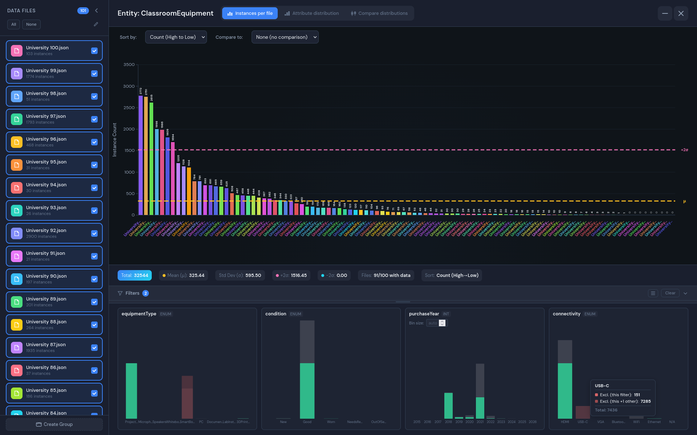

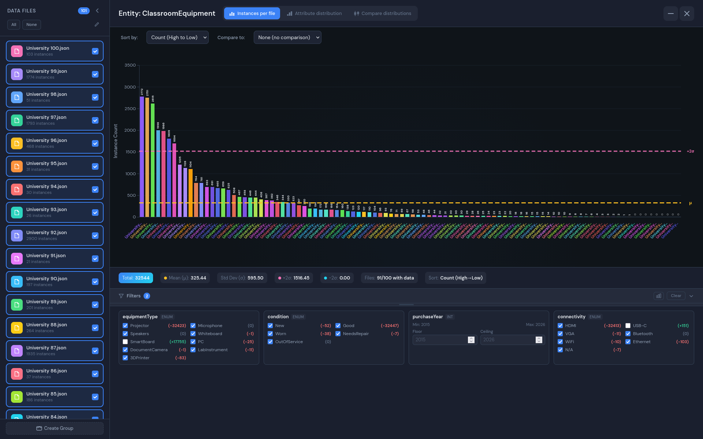

The distance-map setup dialog offers the same instance filters.
